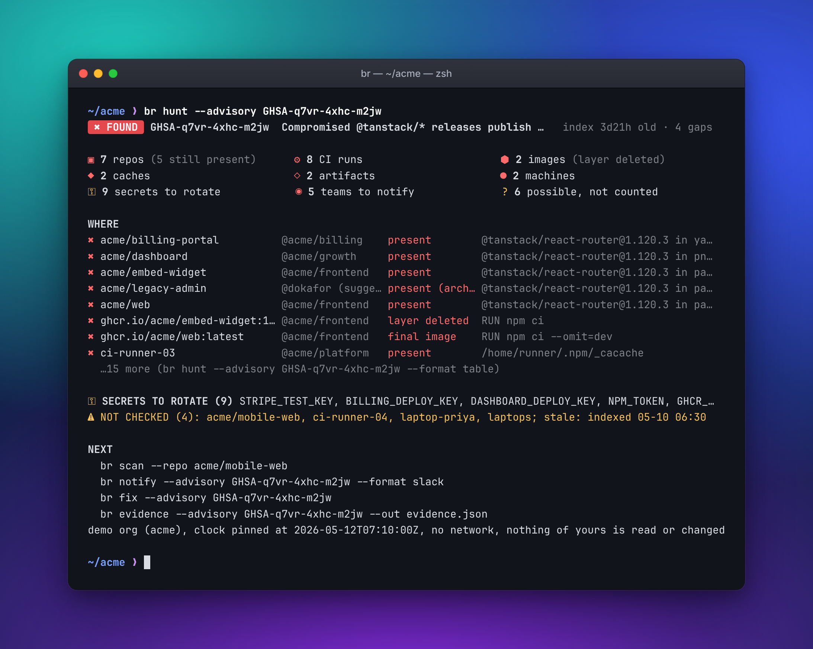
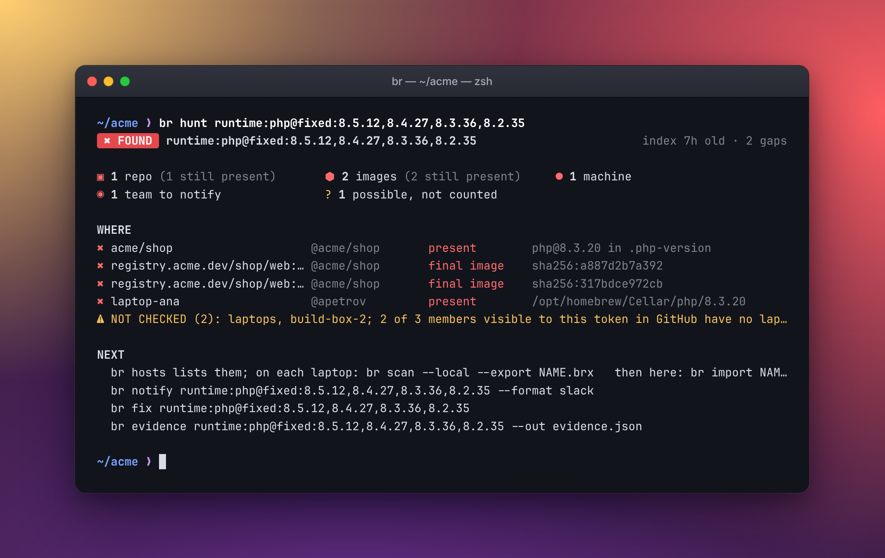
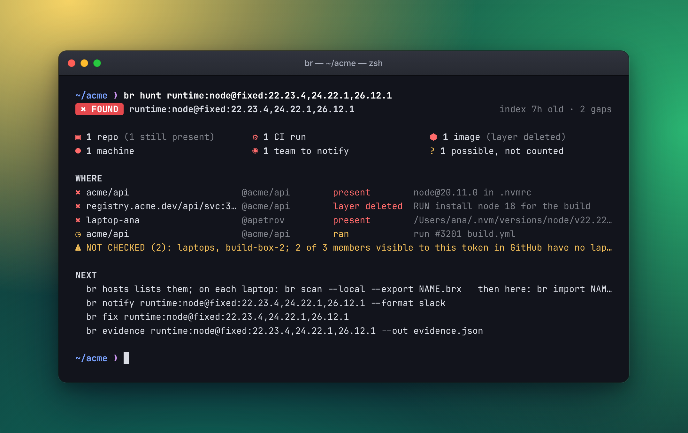
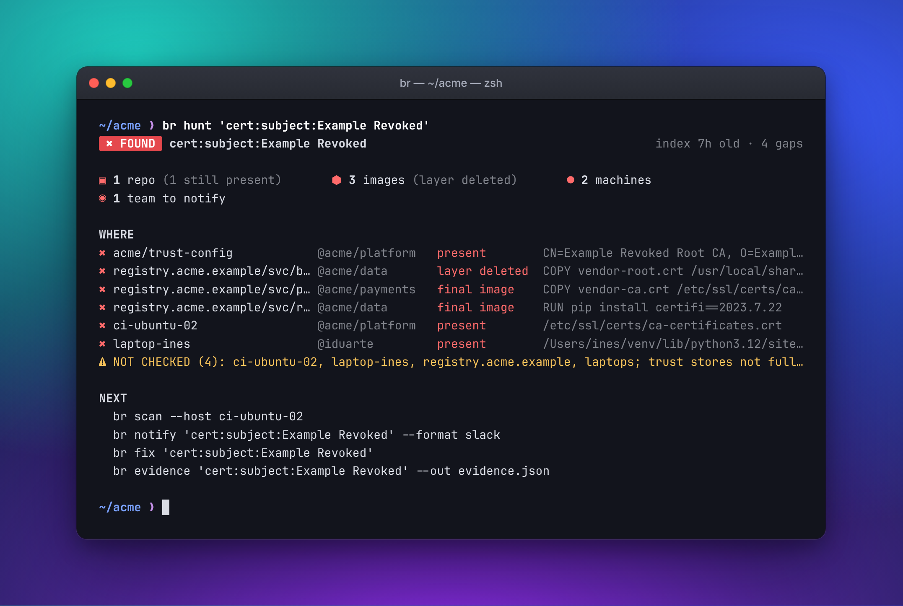
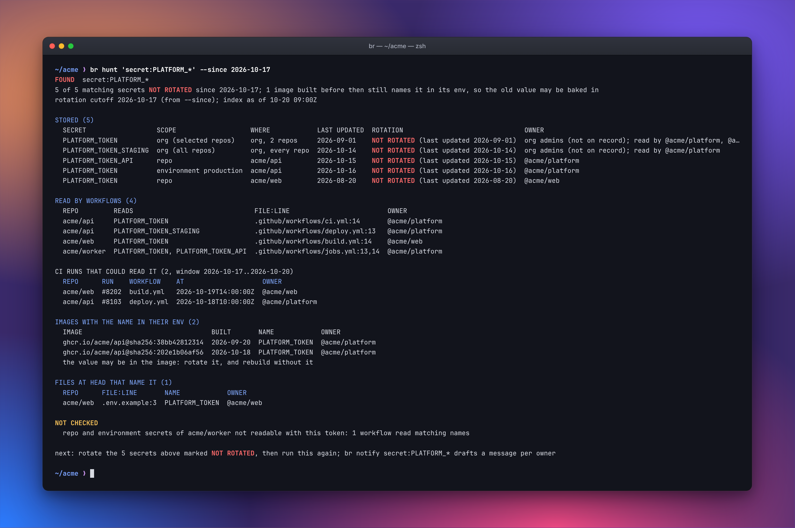

# br (blastradius)

**When something you depend on goes bad, `br` tells you everywhere it is.** That means repos, CI runs and the secrets they held, caches, container images (deleted layers included) and laptops. Then it tells you who owns each place and how to clean up. It runs on your machine and only reads.



## The week of October 2026

In a few days, four incidents landed at once:

- **PHP2Shell** (CVE-2026-109618, CVE-2026-109619): remote code execution in the PHP runtime itself. Fixed in 8.5.12, 8.4.27, 8.3.36 and 8.2.35. Older lines got no release.
- **The Node.js security release of October 21.** Fixed in 22.23.4, 24.22.1 and 26.12.1. End-of-life lines got no fix.
- **The emSign CA keys:** intermediate keys were recoverable, and Chrome is removing the emSign ECC Root CA - G3. Browsers already block the intermediates. The trust stores that are not browsers still trust them: OS bundles in images, certifi, Java cacerts, and PEM files committed to repos.
- **The Railway breach:** customer environment variables were exposed. Every customer has to rotate.

None of these is a bad package version, so a dependency scanner does not answer the questions you actually have. Those questions are: where do we run PHP or Node on a line that is not fixed? Where do we still trust that CA? Where is the platform token stored and read, and was it rotated after the breach? `br` answers all four from one local index of your org.

### Which PHP and Node do we run, and where?

```sh
br hunt runtime:php@fixed:8.5.12,8.4.27,8.3.36,8.2.35
br hunt runtime:node@fixed:22.23.4,24.22.1,26.12.1
```

`fixed:` lists the first fixed release of each line. A version on one of those lines but below the fix is found. A line with no fix at all (end of life) is found too. `br` reads:

- version files (`.php-version`, `.nvmrc`, `.node-version`, `.tool-versions`)
- Dockerfile `FROM` tags and `ENV` versions
- `setup-php` and `setup-node` steps in workflows
- the runtimes installed in images (distro packages included)
- the runtimes on runners and laptops (Homebrew, nvm, the Actions tool cache)

A floating tag such as `php:8-fpm` or `node:lts` could resolve to an affected release. It is reported apart, as possible.





### Where do we still trust that CA?

```sh
br hunt "cert:subject:emSign ECC Root CA - G3"
br hunt cert:SHA256-FINGERPRINT
```

`br` reads the certificates themselves (x509 DER) out of trust stores:

- the OS bundles in every image layer, including a layer a later step deleted
- the certifi copies inside Python environments
- Java cacerts
- PEM bundles committed to repos
- the trust stores on scanned machines

It matches by fingerprint or by subject.



### Where is that token, and did we rotate it?

```sh
br hunt 'secret:RAILWAY_*' --since DATE_OF_DISCLOSURE
```

`br` lists every secret whose name matches, as an org secret, a repo secret or an environment secret, with when it was last updated. Anything not updated since `--since` is NOT ROTATED. It also lists the workflows that read the secret, the images that name it in their environment, and the config files (`.env.example`, compose files, deploy config) that mention it. It works from names and dates only: `br` never reads a secret value.



The screenshots are real `br` runs against a sample org (`acme`), with made-up certificates and names.

## The 60-second story

It is 3 a.m. and a package your org uses was just reported as malicious. Where did it land, what could it reach, and who do you tell?

```sh
br init --org acme                              # once: a read-only GitHub token is enough
br hunt --advisory GHSA-xxxx-xxxx-xxxx          # every place, now or at any time in the exposure window
br notify --advisory GHSA-xxxx-xxxx-xxxx        # one draft per owning team, with the fix and the secrets to rotate
```

`br` reads a local index of your GitHub org, your container registries and the machines you point it at. It reports the repos, CI runs, caches, artifacts, images and machines that hold the bad version, now or in the window. It names the secrets the CI runs could read, and the team that owns each place. It does not say the bad code ran. It says where it was installed.

It also says what it could not check. A clean answer with gaps is `CLEAR WITH GAPS`, never plain clear. That is the point of the tool.

## Try it

Install it ([below](#install), one line), then:

```sh
br demo
```

That is a sample org built into the binary. No token, no network, nothing of yours is read. It prints a six-step tour of a made-up incident. The first real step:

```
$ br demo hunt --advisory GHSA-q7vr-4xhc-m2jw --format summary
Yes. 7 repos, 2 images, 2 machines, 2 caches and 2 build artifacts contain or contained the affected packages (GHSA-q7vr-4xhc-m2jw).
4 people and 2 machines may also be affected but could not be confirmed.
Still present: 5 repos, 2 images, 2 machines, 2 caches and 2 build artifacts.
...
Data as of 05-08 10:00Z–05-12 06:30Z (oldest: laptop-priya). Not checked: 4 sources (acme/mobile-web; ci-runner-04; laptop-priya; laptops: 11 of 12 members visible to this token in GitHub have no laptop scan here). The number can still change.
```

## Where br fits

| | Question it answers | Output |
|---|---|---|
| Dependabot, osv-scanner, trivy | Is a known-vulnerable package in this code or image now? | alerts, PRs, scan reports |
| Socket | Does this package behave badly, before I install it? | a verdict on a package |
| GitHub secret scanning | Has a secret been committed? | alerts |
| **br** | A package is known to be bad. Where did it go, what could it reach, is it really gone? | places, CI runs and secret names, owners, a sealed record |

It complements them. [docs/why.md](docs/why.md) has the honest version, including what `br` does not do, what it sends and where, and a FAQ.

## For your role

One page each, with commands to copy and real output from `br demo`: [on-call AppSec](docs/playbooks/appsec-oncall.md), [platform](docs/playbooks/platform-eng.md), [team lead](docs/playbooks/team-lead.md), [CISO](docs/playbooks/ciso.md), [auditor](docs/playbooks/auditor.md), [IR consultant](docs/playbooks/ir-consultant.md), [SOC analyst](docs/playbooks/soc-analyst.md), [startup CTO](docs/playbooks/startup-cto.md), and [dependency confusion with `br claimcheck`](docs/playbooks/claimcheck.md) (run on a sample registry with `br demo claimcheck`). The index is [docs/playbooks/](docs/playbooks/README.md).

A different incident, with no advisory: someone says they registered your internal package name. `br claimcheck` lists which of your own names (manifests, lockfiles, registry settings, shipped source maps) are SQUATTED, FREE or SCOPE UNCLAIMED on the public registries, with read-only GETs, and only when you run it. The first line gives the total and the gaps in names; the most urgent names are ranked by consequence and said in plain words; each name carries its owning team; an OURS that rests only on a repository URL the publisher typed is told apart from one the registry vouches for. `--as-of DATE` judges by what was published by then, `br notify --claimcheck` drafts one message per owning team, `br evidence --claimcheck` seals the answer for an auditor or a customer, and `--record` with `br diff --claimcheck` shows what changed since last time. See [the claimcheck playbook](docs/playbooks/claimcheck.md). To try it with no token and no network (a small sample registry, labelled as one on every line):

```
$ br demo claimcheck --format summary
Dependency-confusion check, 2026-05-12: EXPOSED: 7 names (3 squatted, 3 free, 1 scope held by someone else); 2 shown to be yours (1 verified by the registry, 1 declared by the publisher).
no index: the manifests and the registry answers are the sample inside this binary.
The answers are from a sample registry, not a public one.
Nothing was published, claimed or changed.
[exit 0]
```

In CI, see [docs/action.md](docs/action.md) for the GitHub Action, `--format sarif` (GitHub code scanning) and the pre-commit hook, or use the checkout gate directly:

```sh
br hunt npm:name@1.2.3 --path . --fail-if found --strict     # no index, no network; exit 10 when found
br claimcheck --path . --org acme --fail-if exposed          # asks the public registries about your names; exit 10 when exposed, 3 if it checked nothing
```

To let an AI agent ask br during an incident, `br mcp` is a read-only MCP server over stdio: [docs/mcp.md](docs/mcp.md).

## Install

With Node 18 or newer, nothing else to set up:

```sh
npx -y @jondot/blastradius demo        # run it once
npm i -g @jondot/blastradius           # or put `br` on your PATH
```

Without Node:

```sh
curl -fsSL https://raw.githubusercontent.com/jondot/blastradius/main/install.sh | sh
```

This downloads the latest release for your OS and architecture, checks its sha256, and installs `br` to `~/.local/bin` (or `$BR_INSTALL_DIR`). Pin a version with `sh -s -- --version v0.1.2`.

For an AI agent, add the skill. It teaches the agent when to reach for br, how to phrase a hunt, and how to read the answer:

```sh
npx skills add jondot/blastradius
```

Or give it br as an MCP server: `claude mcp add blastradius -- npx -y @jondot/blastradius mcp` ([docs/mcp.md](docs/mcp.md)).

In GitHub Actions, use `jondot/blastradius@v1` (see [action.yml](action.yml)).

Builds: Linux (x86_64 and arm64, static musl), macOS (x86_64 and arm64) and Windows (x86_64). Archives are on the [releases page](https://github.com/jondot/blastradius/releases). From source: `cargo install --path .`

## Five commands

Build the index once. A read-only GitHub token is enough:

```sh
export GITHUB_TOKEN=...
br init --org acme
```

Ask whether you are exposed, from an advisory id, an indicator, or pasted advisory text:

```sh
br hunt --advisory GHSA-xxxx-xxxx-xxxx --owner frontend
br hunt pypi:some-package@1.2.3 --fail-if found --quiet     # CI gate: exit 10 when found
br hunt --advisory GHSA-xxxx-xxxx-xxxx --format sarif       # SARIF 2.1.0 for code scanning (also: br claimcheck --format sarif)
```

See what to do about it, then hand the auditor or customer a sealed record:

```sh
br fix --advisory GHSA-xxxx-xxxx-xxxx                        # per repo: how to reach a fixed version
br evidence --advisory GHSA-xxxx-xxxx-xxxx --out evidence.json --sign ~/.ssh/id_ed25519
br evidence --advisory GHSA-xxxx-xxxx-xxxx --out evidence.json --audience customers   # also a plain statement with no internal names
```

The day after, track the cleanup, or check one repo:

```sh
br hunt --advisory GHSA-xxxx-xxxx-xxxx --progress           # per owner: still open, fixed (and when), new since the baseline (the first --progress for this scope)
br hunt --advisory GHSA-xxxx-xxxx-xxxx --repo acme/web      # is my repo ok?
br hunt --similar suspect.js                                # files that look like a sample someone sent you
br hunt sha256:HASH --similar-related                       # also the files that look like the others shipped in the same package install
```

Other commands: `claimcheck` (which of your internal package names a stranger could already own on npm, PyPI, crates.io or the Go proxy), `mcp` (a read-only MCP server for an AI agent), `status` (how fresh each source is, and what the answer did not cover), `scan` (re-read stale or affected sources), `notify` (one draft message per owning team), `purge` (the caches, artifacts, images and paths to delete), `diff`, `verify`, `import`, `hosts`, `teams` (`br teams NAME` shows one), `advisory`, `sql`. Run `br --help` or `br COMMAND --help`.

Laptops with no network path to the index scan themselves and send the result:

```sh
br scan --local --export laptop.brx --seal     # on the laptop
br import laptop.brx                           # on your machine; br hosts lists who is still missing
```

A second file for a machine already in the index is merged by path (the newer scan wins per path) and the line says `merged: +N files, M replaced`; `--replace` swaps the whole machine. `br import FILE --kind laptop --as NAME --owner @login` says what the machine is and what it is called when two machines share a hostname. `br scan --all` refreshes every source br can reach and lists the import-only machines it cannot.

One index per client: `br --home ~/clients/acme init --org acme` (the same as `BR_HOME=~/clients/acme`). `br advisory ID` is `br advisory show ID`; an id the index and your notes do not hold is asked of OSV before br says it is not found, and the error says where it looked.

Indicators: `npm:@scope/name@1.2.3`, `pypi:`, `cargo:`, `go:`, `action:owner/repo@ref`, `sha256:HASH`, `runtime:NAME@fixed:V1,V2`, `cert:HEX` or `cert:subject:TEXT`, and `secret:NAME` (with `*` globs and `--since DATE`). Names are matched whole: `lodash` never matches `lodash.merge`. Advisories are matched by their real version ranges, per package.

Things br cannot know from the outside, you tell it: `br hosts add NAME --kind runner|laptop|server` (or br detects it on the machine), and `br advisory note ID --benign sha256:HASH --why TEXT` for a hash that is known to be safe.

Every answer says how old the index is, how old its oldest source is, and which sources it could not check (a 403, an expired log, an unreadable lockfile). A clear answer with gaps is reported as such, never as plain clear (`--strict` turns that into exit 3). Exit codes: 0 clear, 10 found, 3 clear with gaps under `--strict`, 5 no index or a stale one, 11 nothing found under `--fail-if none`, 4 auth, 2 usage, 1 failure.

## What it reads (read-only)

`br` never writes to anything it reads. Every GitHub call is a GET or HEAD.

- **GitHub org:** repos, lockfiles and manifests with their commit history (npm, yarn, pnpm, PyPI, Cargo, Go), CODEOWNERS, workflow files, Actions runs, caches and artifacts, releases and their assets, teams and members, registered runners, and org container images on GHCR.
- **Container registries:** images, layers and their files by hash, including files a later layer deleted. Uses your existing `docker login` credentials; no token needed.
- **Machines:** a directory tree on this machine (`br init --path DIR`), ssh-reachable hosts and runners, and `.brx` files exported by laptops.
- **Advisories:** OSV, for GHSA and `MAL-` ids; advisory ids in pasted text (`--text`) are fetched too.
- **Public registries, only for `br claimcheck`:** read-only GETs to npmjs.org, pypi.org, crates.io and proxy.golang.org (or the endpoints in `BR_NPM_REGISTRY`, `BR_PYPI_API`, `BR_CRATES_API`, `BR_GOPROXY`), asking about your own package names. A hunt never does this.

The index lives at `~/.local/share/br/index.db` (override with `BR_HOME`). A hunt reads only the index; it touches the network or a machine only when you pass `--now`, `--live` or `--path`. Re-scans use conditional requests, so an unchanged repo costs about 3 API calls.

Evidence is sealed with a sha256 manifest (integrity) and, with `--sign`, signed with `ssh-keygen -Y sign` (identity). `br verify FILE --allowed-signers FILE` checks both.

## License

MIT
